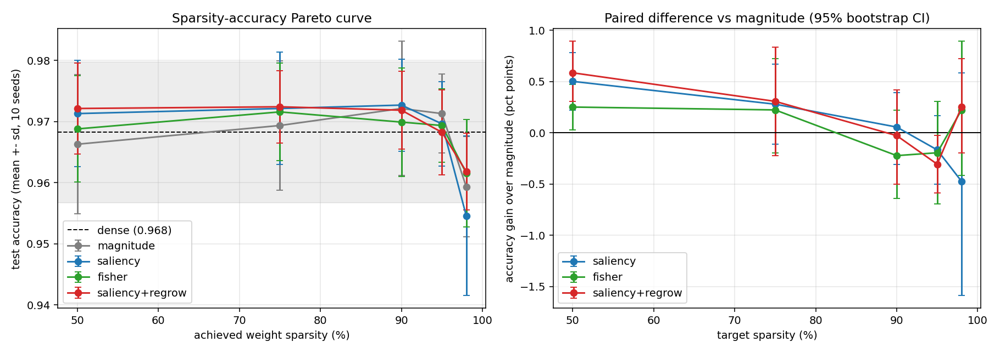

# The Self-Pruning Network (AQUA take-home)

A from-scratch reverse-mode autodiff engine + MLP + Adam in pure NumPy, which prunes its own
connections *while training* under a cubic sparsity schedule, with a sparse-aware inference path and
measured evidence that the pruned model is genuinely cheaper.

**Scikit-learn statement (as required):** scikit-learn is used in exactly one place --
`train/data.py` calls `sklearn.datasets.load_digits` to load the standard 8x8 digits dataset.
No sklearn model, optimizer, metric, or gradient is used anywhere. No PyTorch / TensorFlow / JAX /
Keras / HuggingFace. The autodiff engine, backward pass, pruning mechanism, optimizer and training
loop are all in this repository.

## Install

```bash
python -m venv .venv && source .venv/bin/activate     # Python >= 3.10
pip install -r requirements.txt                       # (or: uv pip install -r requirements.txt)
```

## One command per deliverable

| Deliverable | Command | Writes |
|---|---|---|
| Gradient checks + masked-weight correctness (+ all other tests) | `python -m pytest -q` | -- |
| Only the Part 1 gradient-check suite | `python -m pytest tests/test_gradcheck.py -q` | -- |
| Only the masked-weight / optimizer-state suite | `python -m pytest tests/test_masked.py -v` | -- |
| Part 2: dense training, learning curve | `python -m train.run_part2` | `results/part2_curve.{png,json}` |
| Part 3: one self-pruning run (90%) | `python -m train.run_part3 --sparsity 0.9 --criterion saliency` | `results/part3_*.{png,json}` |
| Part 4: Pareto sweep + paired stats + claim (about 10 min on 1 CPU) | `python -m train.sweep` | `results/pareto.{png,csv}`, `raw_runs.json`, `paired_stats.json`, `claim.md` |
| Part 4: real cost measurement (FLOPs / bytes / wall-clock) | `python -m train.benchmark` | `results/cost.json` |

Everything is seeded (`np.random.default_rng(seed)`, separate streams for split / init / batch order;
no global RNG). The same command gives the same numbers on a clean clone.

## Layout

```
engine/   tensor.py (Tensor, ops, softmax-CE, Parameter+mask)   gradcheck.py (finite differences)
nn/       layers.py (Linear, ReLU, Tanh, MLP; He/Glorot init)    optim.py (SGD+momentum, Adam; mask-aware)
prune/    schedule.py (cubic ramp)  pruner.py (criteria, selection, regrowth)  sparse.py (CSC inference, FLOPs)
train/    data.py  loop.py  experiment.py  run_part2.py  run_part3.py  sweep.py  benchmark.py
tests/    test_gradcheck.py  test_masked.py  test_pruning.py
results/  committed plots + raw numbers
DESIGN.md the four required design answers
```

## Results (all numbers reproduce from the commands above)

**Part 2 -- dense training (`results/part2_curve.png`).** MLP 64-128-128-10, He init, our Adam
(lr 3e-3, batch 64, 60 epochs), seed 0: loss falls from 0.27 to 1e-4 with no NaNs; train acc 100%,
val 96.4%, test 96.9%.

**Part 3 -- one self-pruning run** (`python -m train.run_part3 --sparsity 0.9`, seed 0): 90.0% of
the weights removed (2,586 of 25,856 remain: layer sparsities 82% / 94% / 92%), test accuracy 98.3%
for that seed. Pruned weights are exact zeros in storage, asserted on every run.

**Part 4 -- Pareto sweep** (10 paired seeds; seed controls split, init and batch order; test accuracy
% of the *final* epoch, mean +- sd; `results/pareto.png`, `results/pareto.csv`, `results/raw_runs.json`):

| target sparsity | dense | magnitude | saliency | fisher | saliency+regrow | inference FLOPs |
|---|---|---|---|---|---|---|
| 0% | 96.82 +- 1.15 | - | - | - | - | 1x |
| 50% | - | 96.63 +- 1.14 | 97.13 +- 0.87 | 96.88 +- 0.87 | 97.21 +- 0.74 | 2x fewer |
| 75% | - | 96.94 +- 1.06 | 97.21 +- 0.92 | 97.16 +- 0.80 | 97.24 +- 0.59 | 4x fewer |
| 90% | - | 97.21 +- 1.10 | 97.27 +- 0.75 | 96.99 +- 0.89 | 97.19 +- 0.64 | 10x fewer |
| 95% | - | 97.13 +- 0.64 | 96.96 +- 0.69 | 96.94 +- 0.60 | 96.82 +- 0.70 | 20x fewer |
| 98% | - | 95.93 +- 0.82 | 95.46 +- 1.31 | 96.16 +- 0.88 | 96.18 +- 0.63 | 50x fewer |



**Falsifiable claim** (sparsity level fixed before the sweep; text generated by the sweep from the
committed numbers, `results/claim.md`):

> At 90% target sparsity (achieved 90.0%), saliency pruning retains 97.27% test accuracy (sd 0.75%)
> vs 97.21% (sd 1.10%) for magnitude pruning, mean of 10 paired seeds; dense is 96.82%. Paired
> difference +0.06 pp, 95% bootstrap CI [-0.31, +0.39] pp; saliency won 6, tied 1, lost 3 of 10 seeds
> -- the 95% CI includes zero, so we do NOT claim saliency is better at this sparsity. Inference
> cost: 10.0x fewer FLOPs (2586 of 25856 weights active).

**Is gradient-based pruning better than magnitude? On this task, not detectably.** Differences are
within seed noise at 75-98% (paired CIs in `results/paired_stats.json`). The one consistent gap is at
50% (+0.50 pp saliency, CI [+0.22, +0.78]); with 15 comparisons some chance hits are expected, so I
report it without explaining it. See DESIGN.md section 5 for why, and what experiment would separate them.

**Real cost (`python -m train.benchmark`, `results/cost.json`).** Counted per sample, a multiply-add
being 2 FLOPs and biases/activations excluded: 51,712 dense vs 5,172 at 90% (**10.0x fewer**) and 1,034
at 98% (50x fewer). Weight storage in CSC: 43.5 KB vs 206.8 KB dense (4.75x smaller, fp64 + int64
indices). The sparse path is verified equal to the dense one (1e-10) and is a real sparse forward
(gather of surviving weights only), not dense-times-zero.
**Wall-clock honesty:** my NumPy sparse path is *slower* than dense BLAS (0.37x at batch 1, 0.20x at
batch 32, 0.05x at batch 512 for the 90% model; still slower at 98%). The dense-times-zero shortcut
(`dense_masked_forward`) is kept only as a baseline: it does full dense work, so it is not a speed-up.
FLOPs and memory are the evidence of reduced work; actually converting that into latency needs
compiled sparse kernels or hardware-friendly (structured) sparsity. DESIGN.md section 4 covers this.

**Data note.** `sklearn` digits (1,797 images) is used because it ships with scikit-learn (the sandbox
this was built in had no dataset downloads). It is easy: the dense model fits the training set by
epoch 5. Everything is dataset-agnostic arrays, so Fashion-MNIST/MNIST can be swapped in `train/data.py`.

